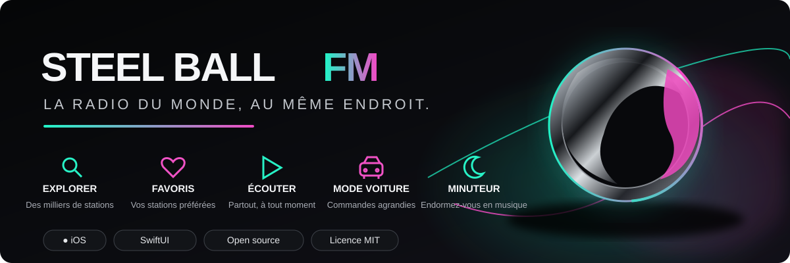

<div align="center">

# STEEL BALL FM

### La radio du monde, au même endroit.

</div>

<div align="center">



### La radio du monde, au même endroit.

Une application iOS native pour découvrir et écouter des radios du monde entier.

<br />


**Open source · Design sombre · Aucune publicité ajoutée par l’application**

</div>

---

## ✦ Découvrez votre prochaine station

**Steel Ball FM** rassemble des stations radio du monde entier dans une interface simple et soignée. Recherchez une station, explorez par pays ou par genre, ajoutez vos favoris et retrouvez facilement vos dernières écoutes.

<table>
  <tr>
    <td width="50%" valign="top">

### ◉ Explorer

- Catalogue de radios du monde entier
- Recherche par nom de station
- Filtres par pays et genre musical

</td>
    <td width="50%" valign="top">

### ♡ Vos favoris

- Enregistrez vos stations préférées sur l’appareil
- Retrouvez les radios récemment écoutées
- Profitez d’une identité visuelle métallique

</td>
  </tr>
  <tr>
    <td width="50%" valign="top">

### ▶ Écouter

- Commandes lecture, pause et arrêt
- Mini-lecteur intégré
- Commandes de lecture système iOS

</td>
    <td width="50%" valign="top">

### ⏱ Garder le contrôle

- Mode voiture avec commandes agrandies
- Minuteur de sommeil : 15, 30, 45 ou 60 minutes
- Tentatives limitées de reconnexion si un flux s’interrompt

</td>
  </tr>
</table>

## ◈ Identité visuelle

Une interface noire, une sphère métallique et des reflets vert menthe et rose : une identité visuelle conçue pour une expérience d’écoute moderne.

> Les visuels de présentation peuvent être illustratifs. Des captures d’écran réelles de l’application seront ajoutées séparément.

## ⚙️ Lancer le projet

### Prérequis

- Un Mac avec Xcode
- Un iPhone sous iOS 17 ou version ultérieure, ou un simulateur iOS
- Une version de Xcode compatible avec le projet

### Installation

1. Clonez ou téléchargez ce dépôt.
2. Ouvrez `SteelBallFM.xcodeproj` dans Xcode.
3. Sélectionnez la cible de l’application `SteelBallFM`.
4. Dans **Signing & Capabilities**, sélectionnez votre équipe de développement Apple.
5. Choisissez votre iPhone ou un simulateur disponible.
6. Cliquez sur **Run**.

**À noter :** la compilation n’a pas été vérifiée indépendamment dans le cadre de ce dépôt. Compilez et testez le projet dans Xcode.

## ◌ Publicité, confidentialité et flux radio

- **Aucune publicité ajoutée :** Steel Ball FM n’intègre pas ses propres annonces. Une station peut toutefois diffuser de la publicité dans son flux audio.
- **Données locales :** les favoris et l’historique d’écoute sont conservés sur l’appareil avec `UserDefaults`.
- **Catalogue :** les informations des stations proviennent de l’[API Radio Browser](https://www.radio-browser.info/).
- **Flux tiers :** la disponibilité, la qualité audio, l’accès régional et les interruptions dépendent de chaque station.

Ces informations décrivent le code source actuel. Elles ne constituent pas un audit de sécurité formel ni une garantie concernant les services tiers.

## ⌘ Structure du projet

```text
Assets.xcassets/   Icône et logo de l’application
Models/            Modèle des stations radio
Services/          Catalogue, lecture audio et données locales
Views/             Interface SwiftUI
SteelBallFMApp.swift
Info.plist
SteelBallFM.xcodeproj/
```

## Contribuer

Vous avez trouvé un bug ou une idée d’amélioration ? Ouvrez une *issue* en décrivant les étapes pour reproduire le problème, ainsi que vos versions d’iOS et de Xcode. Les retours et contributions sont les bienvenus.

## Licence

Projet distribué sous licence [MIT](LICENSE).

<div align="center">

---

**Développé avec SwiftUI par [190yim](https://github.com/190yim)**

<sub>Steel Ball FM · La radio du monde, au même endroit.</sub>

</div>
